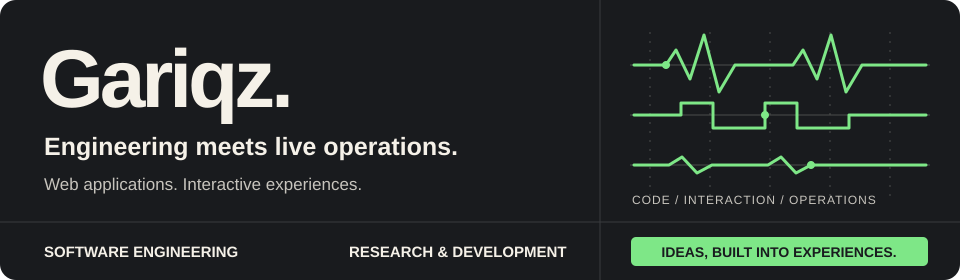
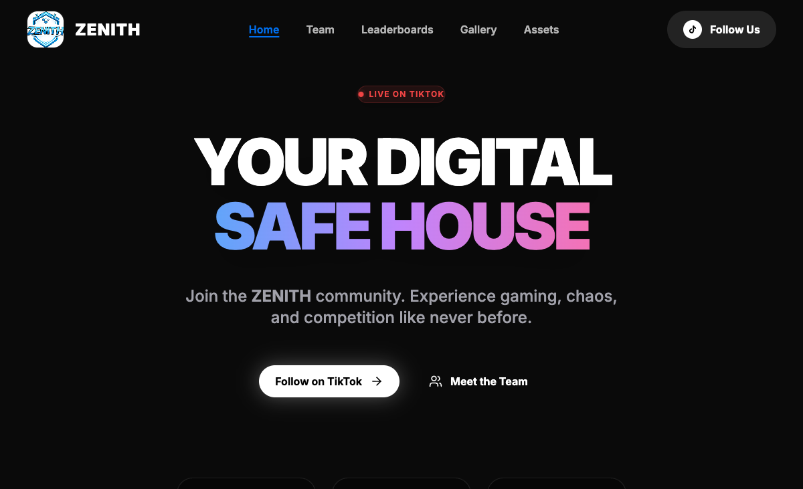
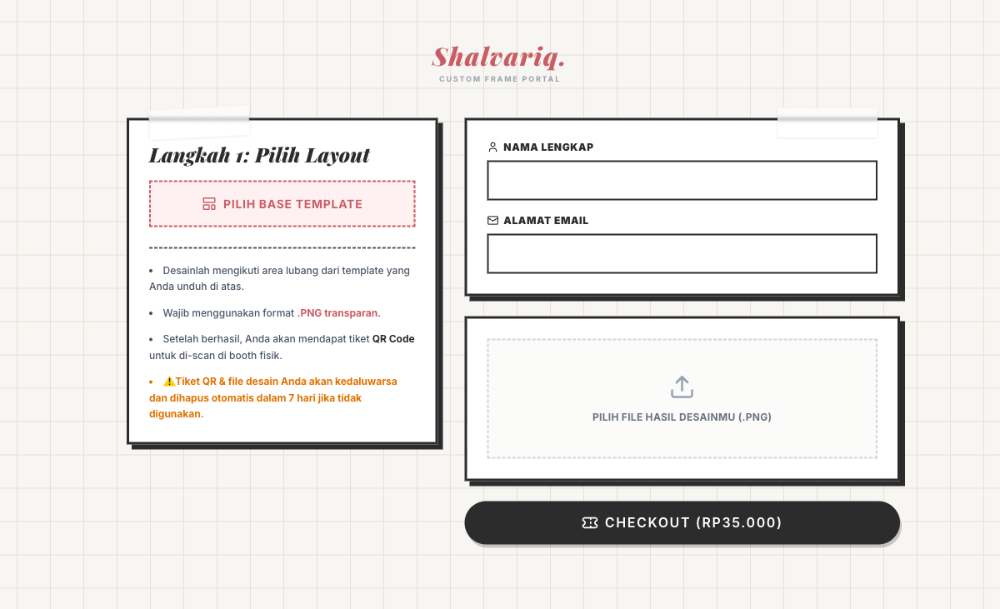
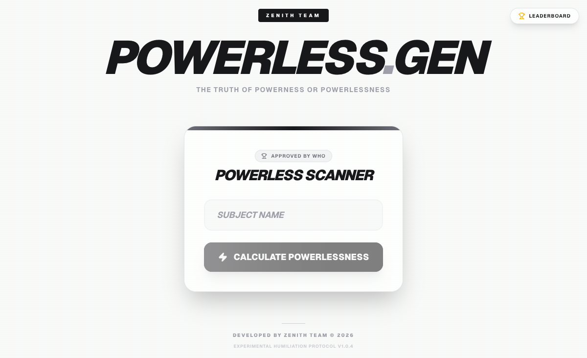

<picture>
  <source media="(prefers-color-scheme: dark)" srcset="assets/header-dark.svg">
  <source media="(prefers-color-scheme: light)" srcset="assets/header-light.svg">
  
</picture>

# Ghassan Ariq · Gariqz

**Software Engineering Student · Head of R&D at Vermiliom**

I build web applications and interactive experiences, and lead R&D at **Vermiliom**, an agency focused on interactive TikTok livestreaming. Alongside development, I oversee the technical side of livestream operations.

[Selected work](#selected-work) · [Technologies](#technologies) · [GitHub activity](#github-activity) · [Experience](#experience) · [Contact](#contact)

## Technologies

Web, desktop, and interactive systems. Tools I've used in projects and experiments—not a proficiency ranking.

**Languages**

  
  
  
  
  
  

**Web & UI**

  
  
  
  
  
  

**Backend & data**

  
  

**Desktop**

  
  
  
  

**Motion & state**

  
  
  
  
  

**Tooling & platform**

  
  
  
  
  
  

<strong>More libraries across my repositories</strong>

Radix UI · AOS · React Router · Chart.js · PrimeReact · Sass · SweetAlert2 · PostCSS

These appear in earlier project manifests, including forks and templates; project exposure is not a claim of independent expertise in every library.

---

## Selected work

From agency workflows to camera interfaces and community experiences. Open each project's engineering notes for a closer look.

### Vermillion ERP

**Agency operations, connected.** A Next.js and Supabase implementation bringing host reporting, HR workflows, and finance into one application.

I independently developed the Next.js / Supabase rebuild. The repository is a fork of [Viserys89/vermillionerp](https://github.com/Viserys89/vermillionerp); the original project and its contributors remain credited.

`Next.js` `React` `TypeScript` `Supabase` `Tailwind CSS`

[Explore source](https://github.com/Gariqz/vermillionerp/tree/main/vermillion-erp-next) · [Business workflows](https://github.com/Gariqz/vermillionerp/blob/main/FLOW.md)

<strong>Engineering notes — rebuilding an agency workflow</strong>

- Rebuilt the application using Next.js and Supabase, following the original Laravel / React workflow.
- Separate application areas for hosts, HR, and finance.
- Source includes host reports, leave requests, complaints, facility requests, and earnings screens.
- Public demo is not currently linked. Operational screenshots and private agency data are intentionally excluded.

### Drovic / Zenith Community

**A home for a livestream community.** Team pages, visual archives, leaderboards, and downloadable community assets in one web experience.

`Next.js` `React` `TypeScript` `Supabase` `Framer Motion`

[Visit website](https://zenith-community.vercel.app/) · [Explore source](https://github.com/Gariqz/drovic-team-website)

<strong>Engineering notes — community content meets motion</strong>

- Independently built the community website.
- Gallery content fetched from Supabase, with TikTok embeds and modal previews.
- Dedicated routes for the team, gallery, leaderboards, and assets.
- Framer Motion and Lenis support animated transitions and scrolling.

### Shalvariq Photobooth

**From webcam to keepsake.** A photobooth application combining timed captures, photo review, frame selection, and a customizable 3D keychain preview.

`Next.js` `TypeScript` `React Three Fiber` `Three.js` `Zustand` `Supabase`

[Open custom-frame portal](https://shalvariq-photobooth.vercel.app/custom) · [Explore source](https://github.com/Gariqz/shalvariq-photobooth)

<strong>Engineering notes — camera, state, and 3D</strong>

- Independently built the application.
- Webcam capture with a countdown, review, and retake flow.
- Shared session state using Zustand.
- Three.js / React Three Fiber keychain preview with shape, color, and attachment choices.
- The linked public page accepts custom-frame uploads and offers checkout; it is not a free demo of the complete on-site photobooth flow.

### Powerless Generator

**A playful experiment for creators.** A name-based entertainment experience with animated feedback and shareable results, built for community participation—not real-world assessment.

`Next.js` `React` `TypeScript` `Tailwind CSS` `Framer Motion`

[Try the experience](https://powerless-generator.vercel.app/) · [Explore source](https://github.com/Gariqz/Powerless-Generator)

<strong>Engineering notes — a small, focused interaction</strong>

- Independently built the web experience.
- Name-based calculation presented through an animated interface.
- Result presentation and sharing designed around creator communities.
- An entertainment project, not a security, medical, or psychological assessment tool.

## GitHub activity

A year of building, in green. Real contribution data—not a skill score or a count of every local commit.

<a href="https://github.com/Gariqz?tab=overview">
  <picture>
    <source media="(prefers-color-scheme: dark)" srcset="assets/activity-dark.svg">
    <source media="(prefers-color-scheme: light)" srcset="assets/activity-light.svg">
    
  </picture>
</a>

[Explore contribution history](https://github.com/Gariqz?tab=overview) · [How this updates](assets/README.md)

Snapshot of GitHub-reported contributions. Counts follow GitHub's eligibility and visibility rules; no private repository names or work details are published.

## Experience

### Head of R&D · Vermiliom

**September 2025–Present**

- Lead research and development for an interactive TikTok livestreaming agency.
- Oversee technical operations supporting livestream experiences.
- Build web applications and explore tools for interactive experiences.

Alongside my agency work, I'm studying **Software Engineering**—connecting what I learn with the products and systems I build.

<strong>Beyond the web — GameSpot / Steam Clone</strong>

A Steam-inspired desktop application built with **Java, JavaFX, and Maven**, with a MySQL connector in the project dependencies. A different environment for exploring application structure and desktop interfaces.

[Explore the project](https://github.com/Gariqz/steam-clone)

## Contact

Interested in web applications, interactive experiences, or livestream technology?

**[Email me](mailto:ghassanariq7@gmail.com)** · [Browse all repositories](https://github.com/Gariqz?tab=repositories)

Built around real projects. Always learning, always building.
